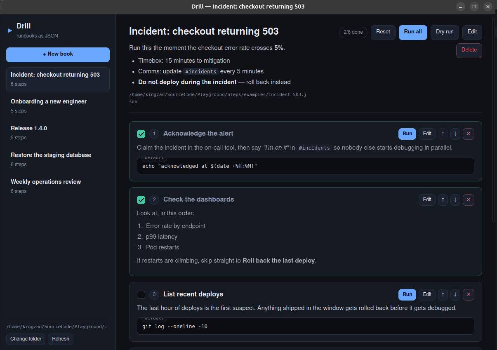

# Drill

**Write the drill. Run the drill.**

Drill turns manual processes — release runbooks, onboarding checklists,
recovery procedures — into plain JSON files you can read, diff, commit, and
execute. A **Book** is one process; it holds an ordered list of **Steps**. Each
step has a title, a markdown description, and optionally a shell command or an
inline script that Drill can run on the spot, capturing stdout, stderr and the
exit code.

There are two front ends over one engine:

- a **desktop app** (native window, no browser),
- a **`drill` CLI** for scripts, CI and AI agents.

Steps can be ticked off as you work through a book. A book-level **Reset** clears
them for the next run — without touching the book file itself.



*Books on the left, the open runbook in the middle, each step with its own
description, command and run button.*

## Why a file, not a service

A runbook that lives in a database drifts away from the code it describes. A
Book is one JSON file with stable field order and no timestamps, so it lives in
git next to the thing it documents, and a review of the diff *is* the review of
the procedure.

## Get started

```bash
git clone <this repo> && cd Drill

# CLI
go build -o drill ./cmd/drill

# Desktop app (Linux: needs libgtk-3-dev and libwebkit2gtk-4.0-dev or 4.1-dev)
wails build && ./build/bin/Drill
```

Point the desktop app at a folder with **Change folder**, or set `DRILL_DIR`:

```bash
DRILL_DIR=./examples ./build/bin/Drill
```

The CLI does the same thing from a terminal:

```bash
./drill new release-1-4-0 --title "Release 1.4.0" --dir runbooks
./drill add release-1-4-0 --title "Run the tests" --command "go test ./..." --dir runbooks
./drill add release-1-4-0 --title "Announce" --description "Post the notes in #releases." --dir runbooks
./drill run release-1-4-0 --dir runbooks
```

```
[1/3] Run the tests
        $ go test ./...
        | ok  github.com/kingzad/drill/internal/book  0.011s
        [ok] (1.2s)

[2/3] Announce
        [ok] (0ms)

run finished in 1.2s
```

Describe a step that fails and Drill stops there, unless the step sets
`"continueOnError": true`. Add `--dry-run` to see what would run, or `--json` to
get the same result the desktop app receives.

## A Book

`runbooks/release-1-4-0.json`:

```json
{
  "version": 1,
  "id": "release-1-4-0",
  "title": "Release 1.4.0",
  "description": "Cut, verify and publish the **1.4.0** release.",
  "defaults": {
    "shell": "sh",
    "cwd": "..",
    "timeoutSeconds": 300
  },
  "steps": [
    {
      "id": "run-tests",
      "title": "Run the test suite",
      "description": "Everything must be green before tagging.",
      "command": "go test ./..."
    },
    {
      "id": "build",
      "title": "Build the CLI",
      "script": "set -euo pipefail\nmkdir -p build\ngo build -o build/drill ./cmd/drill\n",
      "timeoutSeconds": 600
    },
    {
      "id": "announce",
      "title": "Post the release notes",
      "description": "A checklist item: no command, because a human does it."
    }
  ]
}
```

Rules worth knowing:

- `command` and `script` are mutually exclusive; a step may have neither.
- `shell` is `sh`, `bash`, `pwsh`, `powershell`, `cmd` or `python`. Defaults:
  `sh` on Linux/macOS, `pwsh` (or `cmd`) on Windows.
- `cwd` resolves relative to the book file. A missing directory fails the step.
- No timeout set anywhere means 10 minutes.
- Ids are lowercase with `-` and `_`; the file is `<id>.json`.
- Unknown JSON fields are rejected, so a typo in `"command"` is an error instead
  of a silently unrunnable step.

## CLI

```
drill <command> [flags] [args]

list      List books                          [--dir DIR] [--json]
show      Print one book as JSON              <book>
new       Create an empty book                <id|title> [--title T]
validate  Validate one book or the folder     [book...]
add       Append or insert a step             <book> --title T [--command C | --script S]
update    Change fields of a step             <book> <step-id> [flags]
remove    Delete a step                       <book> <step-id>
move      Reorder a step                      <book> <step-id> --to N
run       Execute a book                      <book> [--step ID ...] [--dry-run] [--json]
```

Flags may appear before or after positional arguments. `--script -` reads the
body from stdin, which is the usable form for CI and agents:

```bash
printf 'set -eu\nmake publish\n' | drill add release-1-4-0 --title Publish --script -
```

Exit codes: `0` success · `1` failure (failed run, invalid book, I/O) · `2` usage.

## Tracking progress

Each step has a checkbox; the header shows how many are done. Tick as you go,
then hit **Reset** when you start a new release.

Ticks are stored **outside** the book, in `<UserConfigDir>/drill/progress.json`,
keyed by the book's path. That is deliberate: a book belongs in git, and ticking
a step must not dirty your working tree or collide with a teammate's ticks. The
book file stays byte-identical while you work through it.

## Where books live

The desktop app remembers the last folder in
`<UserConfigDir>/drill/config.json`, and tick state in
`<UserConfigDir>/drill/progress.json`. Resolution order at startup:

1. `DRILL_DIR`
2. the last folder you chose
3. the current directory, if it contains a file that loads as a Book
4. `~/Drill`

Nothing is written outside that folder.

## Development

```bash
go test ./...      # book, engine, store, CLI and desktop bindings
go vet ./...
go run ./tools/icon   # regenerate build/appicon.png + build/windows/icon.ico
```

- [`IMPLEMENTATION.md`](IMPLEMENTATION.md) — architecture, format spec, execution
  semantics, security, packaging.
- [`TASKS.md`](TASKS.md) — what is done, what is left, and how each task is
  verified.

## Status

Working: book CRUD, execution with streaming output, timeouts (process tree
killed), dry run, stop button, markdown descriptions, folder picker, per-step
checkmarks with a book-level reset, CLI.

Not yet: run history, variables/secrets, installers, CI builds for all three
platforms, a Windows-specific engine test.

## License

MIT — see [LICENSE](LICENSE).
